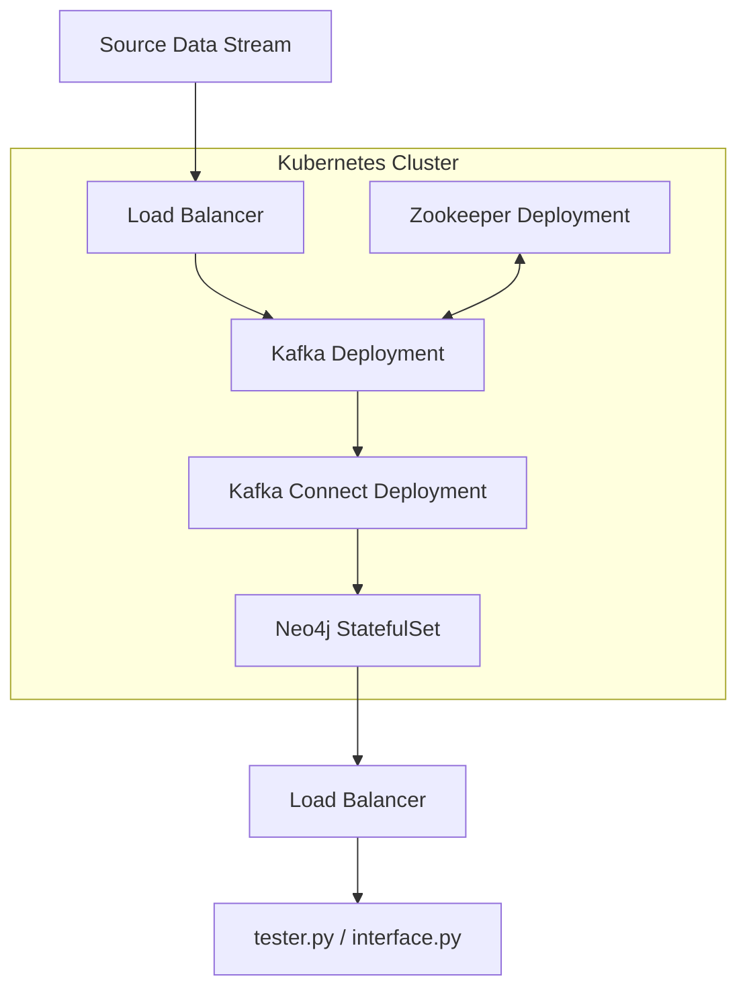

# 🚀 End-to-End Real Time Data Streaming Pipeline with Kubernetes, Kafka & Neo4j
### Scalable Graph Analytics on NYC Yellow Taxi Data


---

## 🎯 Project Overview

This project shifts from a static, standalone Docker setup into a highly scalable, distributed, and fault-tolerant architectural tech stack designed to solve real-world data engineering problems. By leveraging container orchestration, we built a robust pipeline that streams NYC Yellow Cab trip data into Neo4j using Apache Kafka and Kubernetes. 

**Dataset:** NYC Yellow Cab dataset for March 2022.

**Key Goals:**
* Establish a fault-tolerant streaming architecture utilizing stateless components (Kafka, Zookeeper, Kafka Connect) and stateful deployments (Neo4j).
* Auto-ingest JSON data from Kafka topics into Neo4j via a custom Sink Connector.
* Perform near real-time graph-processing tasks, computing important vertices via PageRank and shortest paths via Breadth-First Search (BFS) algorithms.

---
## 🧱 System Architecture


## 🧱 System Architecture & Data Flow

The data pipeline follows a modular sequence:
1. **Source Data Stream:** A Python producer reads taxi trip records, filters for outliers, converts rows to JSON, and publishes messages to the `nyc_taxicab_data` Kafka topic.
2. **Ingestion (Kafka & Zookeeper):** Apache Kafka (coordinated by Zookeeper) buffers the streaming messages in a distributed log. 
3. **Transformation (Kafka Connect):** A Kafka Connect worker running the Neo4j sink connector subscribes to the topic, parses the JSON, and merges the graph data into the database automatically.
4. **Storage & Analytics (Neo4j):** Deployed as a StatefulSet in the Kubernetes cluster, the Neo4j database safely stores the graph and executes GDS algorithms, preserving data even if pod restarts occur.

---

## 📈 Graph Schema Design

The dataset is modeled as a directed network of taxi movements.
* **Nodes (`Location`):** Each unique taxi zone represents a node, identified by its zone ID.
* **Relationships (`TRIP`):** A trip from a pickup location to a drop-off location.
    * *Properties:* `distance`, `fare`, `pickup_dt`, `dropoff_dt`.

**Example Cypher Mapping:**
```cypher
(:Location {name: 47})-[:TRIP {distance: d, fare: f, pickup_dt: t1, dropoff_dt: t2}]->(:Location {name: 159})
```

---

## 📊 Graph Algorithms & Empirical Results

Using the Neo4j Graph Data Science (GDS) library, we projected the Neo4j graph into an in-memory graph to leverage highly optimized, parallelized computations.

### 1. PageRank (Hub Detection)
PageRank computes a centrality score for each Location based on incoming trips, weighted by the importance of their source nodes.
* **Findings:** The algorithm revealed a clear ranking of zones by traffic importance. 
* **Results:** Node 159 emerged as a major hub with the highest top score of `3.22825`, whereas Node 59 saw relatively few incoming trips with the lowest score of `0.18247`.

### 2. Breadth-First Search (Shortest Path)
BFS is a traversal algorithm utilized to find the shortest path (in terms of the number of hops) between a start node and a target node.
* **Findings:** Even with thousands of trip relationships, the GDS BFS procedure traversed the graph almost instantly.
* **Results:** When querying the shortest path between Zone 167 and Zone 78, the optimal route was computed as `167 -> 159 -> 78`.

---

## 🛠️ Kubernetes Deployment Steps

### 1. Zookeeper & Kafka 
Deployed using `confluentinc/cp-kafka:7.3.3`. The Kafka service utilized internal endpoints (`29092`) for the cluster and external endpoints (`9092`) via `KAFKA_ADVERTISED_LISTENERS` to allow outside producers to connect.
```bash
kubectl apply -f ./zookeeper-setup.yaml
kubectl apply -f ./kafka-setup.yaml
```

### 2. Neo4j StatefulSet via Helm
Deployed the official Neo4j Helm chart. We utilized a custom `neo4j-values.yaml` to set passwords and auto-enable the GDS plugin using `NEO4J_PLUGINS: '["graph-data-science"]'`.
```bash
helm install my-neo4j-release neo4j/neo4j -f neo4j-values.yaml
kubectl apply -f neo4j-service.yaml
```

### 3. Kafka Connect to Neo4j Sink
Deployed a custom image (`roy012299/kafka-neo4j-connect:latest`) mapping `CONNECT_BOOTSTRAP_SERVERS` to Kafka and `CONNECT_NEO4J_URI` to Neo4j.
```bash
kubectl apply -f kafka-neo4j-connector.yaml
```

---

## 💡 Learnings & Future Scope

* **Orchestration:** Moving from Docker to Kubernetes highlighted the resilience of decoupling data ingestion from the database. If the Neo4j pod crashes, Minikube automatically restarts it, and Kafka ensures no stream data is lost during downtime.
* **Networking:** Correctly configuring Kafka in a Kubernetes environment requires strict handling of advertised listeners to allow host-machine Python scripts to communicate with cluster-internal services.
* **Future Additions:** The architecture can be further optimized by implementing a Neo4j cluster mode for high availability, utilizing Kafka topic partitioning for parallel processing, and shifting Kafka to KRaft mode to operate without ZooKeeper.

---
